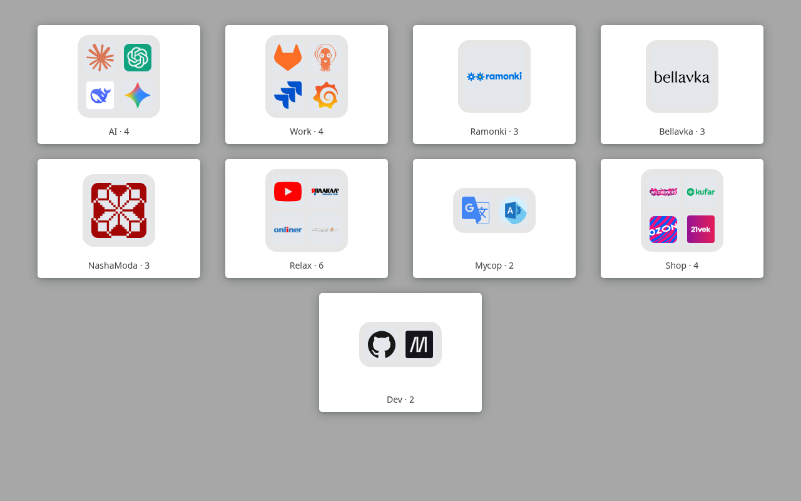

# Custom Start Page

Расширение для Chrome, которое заменяет страницу новой вкладки быстрой минималистичной сеткой ваших сайтов. Сайты можно объединять в папки.



## Возможности

- Сетка карточек с логотипами и названиями сайтов
- Папки: сайты с одинаковым `group` объединяются в одну карточку-папку, которая открывается поверх страницы
- Светлая и тёмная тема (автоматически, по настройкам системы)
- Если логотип не загрузился, показывается первая буква названия
- Без разрешений, без аналитики, без запросов в сеть (см. [PRIVACY.md](PRIVACY.md))

## Быстрый старт

Требования: Node.js 20.19+ или 22.12+, npm 10+.

```bash
npm install
npm run build
```

Установка в Chrome:

1. Откройте `chrome://extensions/`.
2. Включите «Режим разработчика».
3. Нажмите «Загрузить распакованное расширение» и выберите папку `dist/`.
4. Откройте новую вкладку.

После изменений пересоберите проект (`npm run build`) и нажмите кнопку обновления на карточке расширения в `chrome://extensions/`.

## Инструкция: как пользоваться

- **Открыть сайт**: клик по карточке.
- **Открыть папку**: клик по карточке-папке. На ней показаны до 4 логотипов и количество сайтов (`Название · N`).
- **Закрыть папку**: клик по затемнённому фону или клавиша `Esc`.

## Инструкция: как добавить, изменить или удалить сайт

Весь список лежит в `src/data/sites.json`, это массив объектов. После правки выполните `npm run build` и обновите расширение.

```json
{
  "url": "https://example.com/",
  "image": "/img/example.png",
  "title": "Example",
  "group": "Dev"
}
```

| Поле    | Обязательное | Описание |
|---------|--------------|----------|
| `url`   | да           | Адрес, на который ведёт карточка. Должен быть уникальным |
| `image` | да           | Путь к логотипу относительно `public/`, например `/img/example.png`. Подходят PNG и SVG |
| `title` | да           | Подпись под карточкой |
| `group` | нет          | Название папки. Без него сайт отображается отдельной карточкой |

Шаги для нового сайта:

1. Положите логотип в `public/img/` (желательно квадратный, SVG или PNG).
2. Добавьте объект в `src/data/sites.json`.
3. Запустите `npm test`: он проверит поля, наличие файла логотипа и дубли `url`.
4. Пересоберите (`npm run build`) или проверьте в dev-режиме (`npm run dev`).

Правила:

- Папка появляется на месте **первого** сайта с данным `group`; порядок карточек повторяет порядок в файле.
- Название папки чувствительно к регистру: `Work` и `work` — разные папки.
- Если у всех сайтов папки один и тот же логотип, на превью он показывается один раз.
- Чтобы удалить сайт, удалите объект из файла. Неиспользуемый логотип можно удалить из `public/img/`.

## Разработка

```bash
npm run dev       # dev-сервер: http://localhost:3000/newtab.html
npm run build     # production-сборка в dist/
npm run preview   # локальный просмотр сборки
npm test          # тесты (vitest): логика раскладки и проверка sites.json
npm run lint      # ESLint с автоисправлением
npm run package   # сборка + архив new-tab-extension.zip для публикации
```

Устройство проекта: [docs/DEVELOPMENT.md](docs/DEVELOPMENT.md). Деплой и выпуск версий: [docs/DEPLOY.md](docs/DEPLOY.md).

## Структура проекта

```
├── manifest.json         # манифест расширения (MV3); version подставляется из package.json при сборке
├── public/
│   ├── icons/            # иконки расширения 16/32/48/128
│   ├── img/              # логотипы сайтов
│   └── favicon.ico
├── src/
│   ├── main.js           # точка входа
│   ├── App.vue           # сетка верхнего уровня
│   ├── components/
│   │   ├── BaseCard.vue      # общая оболочка карточки
│   │   ├── SiteCard.vue      # карточка сайта
│   │   ├── FolderCard.vue    # карточка-папка
│   │   └── FolderDialog.vue  # окно папки (нативный <dialog>)
│   ├── lib/layout.js     # группировка сайтов в папки, превью папки
│   ├── styles/theme.css  # CSS-переменные, светлая и тёмная темы
│   └── data/sites.json   # список сайтов
├── store/                # материалы для Chrome Web Store
├── docs/DEVELOPMENT.md   # техническая документация
├── docs/DEPLOY.md        # деплой и релизы
├── newtab.html           # HTML-шаблон
├── vite.config.js        # сборка, генерация manifest.json, настройки тестов
└── .github/workflows/release.yml
```

## Разрешения и приватность

Расширение не запрашивает разрешений: оно только подменяет страницу новой вкладки (`chrome_url_overrides`). Данные не собираются и никуда не отправляются. Подробности в [PRIVACY.md](PRIVACY.md).

## Технологии

Vue 3 (`<script setup>`), Vite, Vitest, ESLint + Prettier.
